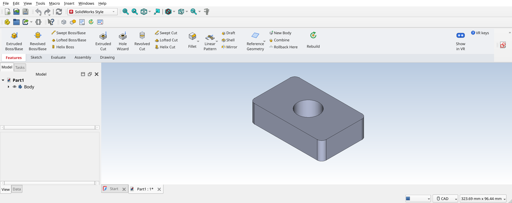
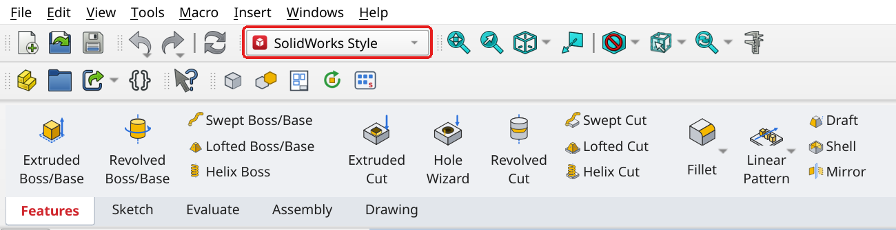
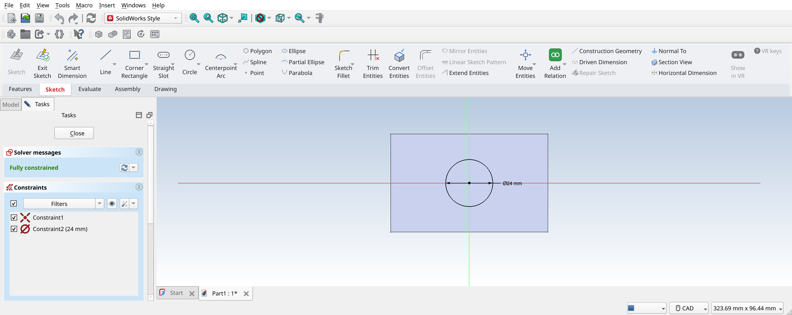
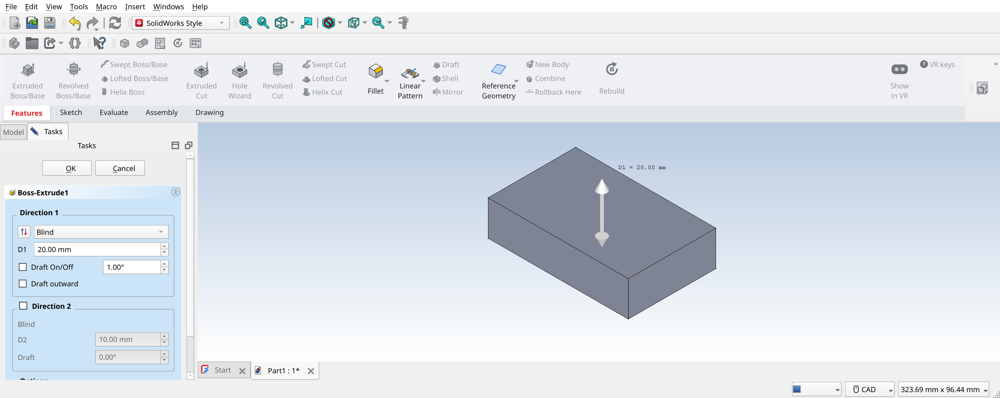
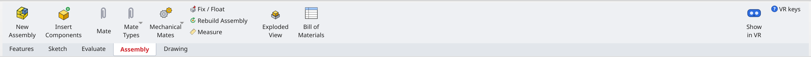
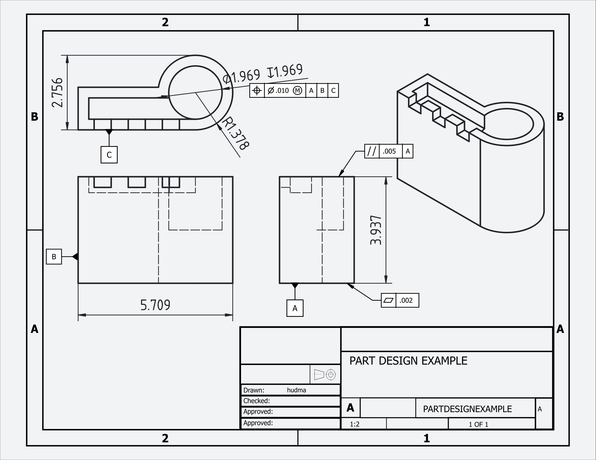
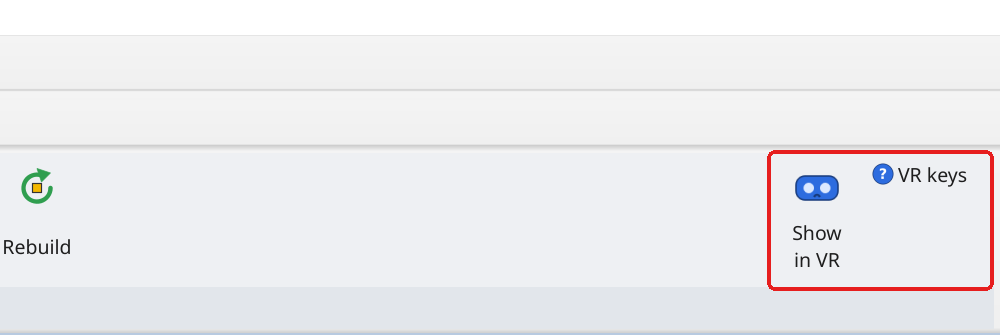

# SolidWorks Style workbench for FreeCAD

Makes FreeCAD 1.1 (1.0 works too) look and work like SolidWorks: a CommandManager ribbon with SolidWorks tool names,
SolidWorks-style feature panels and shortcuts, and the light SolidWorks colour scheme.
With SteamVR (Windows or Linux) there's an extra: **Show in VR** floats the part you're editing in your headset,
for example a Steam Frame connected to the PC with Steam Link.



---

## 1. Install FreeCAD
Install **FreeCAD 1.1** (1.0 also works) from <https://www.freecad.org/downloads.php>
(Linux: `flatpak install flathub org.freecad.FreeCAD` works too). Start it once, then close it.

## 2. Download this workbench
On this GitHub page, click the green **Code** button → **Download ZIP**, then unzip it.
(Or `git clone git@github.com:HappyPhoton26/FreeCAD_SolidWorksUI.git`.)

## 3. Run the installer

### Windows
1. Close FreeCAD.
2. Open the unzipped folder and double-click **`install.bat`**.
   If Windows shows "Windows protected your PC", click **More info → Run anyway**.
3. It asks whether to also copy my FreeCAD settings (look, mouse/navigation, toolbars, units) so it looks
   exactly like my setup: press **Enter** for yes (close FreeCAD first), or type `n`.
4. The window shows where the workbench was installed. Press any key to close it.

This installs the workbench **and the VR viewer** (to `%LOCALAPPDATA%\fcvr`).

It installs into the right folder for each FreeCAD version it finds (FreeCAD 1.1 keeps add-ons in
`%APPDATA%\FreeCAD\v1-1\Mod`, 1.0 in `%APPDATA%\FreeCAD\Mod`), and moves older copies of this workbench
out of the way. Your old settings are kept as `user.cfg.before_install_<date>`.

Options (open a Command Prompt in the folder): `install.bat -MySettings` copies the settings without asking,
`install.bat -NoSettings` never touches them, `install.bat -NoVR` skips the VR viewer.

> Manual install (if the script doesn't work): copy the `SolidStyle` folder into FreeCAD's `Mod` folder.
> To find that folder, open FreeCAD → **View → Panels → Python console** and type `App.getUserAppDataDir()`.
> For FreeCAD 1.1 it's `%APPDATA%\FreeCAD\v1-1\Mod` (1.0: `%APPDATA%\FreeCAD\Mod`). Restart FreeCAD afterwards.

### Linux
```
cd FreeCAD_SolidWorksUI
./install.sh
```
Options: `--no-vr` (skip the VR viewer), `--my-settings` (also copy my exact FreeCAD settings; close FreeCAD first).

### macOS
Copy the `SolidStyle` folder into FreeCAD's `Mod` folder (find it with `App.getUserAppDataDir()` as above,
usually `~/Library/Application Support/FreeCAD/Mod`) and restart FreeCAD.

---

## 4. Turn it on
Start FreeCAD and choose **SolidWorks Style** in the workbench drop-down list on the toolbar:



The first time, it switches FreeCAD to the SolidWorks look: light theme, blue-to-white background,
grey parts with black edges, middle-mouse rotate.
**Tools → Restore My Settings** puts your old look back. You can switch back to it any time from the same list.

To start in it every time: **Edit → Preferences → General → Start up workbench → SolidWorks Style**.

---

## 5. Using it

### The CommandManager (ribbon)
The tabs under the buttons switch between **Features, Sketch, Evaluate, Assembly, Drawing**, just like SolidWorks.
Hover over any button to see what it does, plus the original FreeCAD name.

### Making a feature (Extruded Boss/Base example)
1. Click **Extruded Boss/Base**.
2. Pick a plane or a flat face; a sketch opens and the ribbon jumps to the **Sketch** tab.
3. Draw your profile (Corner Rectangle, Circle, Smart Dimension...).

   

4. Click **Exit Sketch** (or the green tick in the top-right of the view).
5. The **Boss-Extrude** panel opens on the left: choose the end condition (Blind, Through All, Up To Surface,
   Mid Plane...), type the depth or **drag the arrow** in the view, then click **OK**.

   

**Extruded Cut, Revolved Boss/Cut, Fillet, Chamfer, Shell and Hole Wizard** work the same way.
Double-click a feature in the tree to edit it with the same panel.

### Assemblies
On the **Assembly** tab: **New Assembly → Insert Components → Mate**. The first part is fixed automatically,
like SolidWorks' (f). Then pick a face or edge on each of two parts.



### Drawings (ANSI, inches) and GD&T
Select a part (or have a body active) and click **Make Drawing from Part** on the **Drawing** tab.
It picks an ANSI sheet (A to E) and a standard scale that fit, places the Front, Top and Right views
(third angle, hidden lines dashed) and an isometric view, fills in the title block and switches the
document to decimal inches. Leave **Auto dimension** ticked to add the overall sizes, plus one diameter or
radius per circle. Hole diameters are written as callouts like `2X ⌀.250 THRU` or `⌀.500 ↧.750`.



| Tool | Does |
|---|---|
| Hole Callout | Pick circles in a view: count, diameter and THRU/depth from the model |
| Geometric Tolerance | Feature control frame, all 14 ASME Y14.5 symbols, ⌀ zone, Ⓜ/Ⓛ, up to three datums. Select an edge first to attach it with a leader, or a dimension to put it under the dimension |
| Datum Feature | Select an edge in a view: datum symbol with its triangle on the edge (next free letter suggested) |
| Basic Dimension | Boxes the selected dimensions (theoretically exact) |
| Title Block | Edit the fields. Scale and weight stay up to date (weight uses the density from Mass Properties) |
| Save as PDF | The current sheet as a PDF |

### Shortcuts
| Key | Does |
|---|---|
| Ctrl+1 … Ctrl+7 | Standard views (Front, Back, Left, Right, Top, Bottom, Isometric) |
| Ctrl+8 | Normal To |
| F | Zoom to fit |
| S | Shortcut bar at the mouse |
| Ctrl+B | Rebuild |

More detail: [SolidStyle/README.md](SolidStyle/README.md).

---

## 6. Show the model in VR (Windows or Linux, with SteamVR)
The installer sets this up. You need **SteamVR** (free on Steam) and a headset it can see.

**Steam Frame on Windows (Steam Link / VR link):** install Steam and SteamVR on the PC, connect the Frame to the
PC with Steam Link, and make sure SteamVR is running (you'll see the SteamVR home or dashboard in the headset).
FreeCAD stays on the PC's desktop; the model appears in the headset.
On Linux the installer builds the viewer, which needs `gcc`.

1. Start SteamVR and put the headset on (or have it ready).
2. In FreeCAD, click **Show in VR** at the right end of the ribbon. It's on every tab.
   Click it again to hide the model.

   

3. The part you're editing floats in front of you at **real size**, and updates live while you keep working on
   the desktop. It **follows the FreeCAD view**: rotate, zoom or pan in FreeCAD and the VR model rotates, grows or
   shrinks, and moves the same way (the point in the middle of the FreeCAD view stays put in VR).
   **Ctrl+Alt+4** switches this off and on.
4. Controllers: **grip** grabs and moves it, **both grips** stretch to scale it, **grip + thumbstick** scales it.
5. **VR keys** (next to the button) shows the keyboard shortcuts:

| Keys | Does |
|---|---|
| Ctrl+Alt+V | Show / hide the model in VR (same as the button) |
| Ctrl+Alt+S | Type a scale (1 = real size, 5 = 5x bigger) |
| Ctrl+Alt+1 | Real size (1:1) |
| Ctrl+Alt+2 / 3 | Big (about 1.2 m) / desk size (about 35 cm) |
| Ctrl+Alt+= / - | 1.5x bigger / smaller |
| Ctrl+Alt+Arrows | Move left / right / up / down (1 cm per press) |
| Ctrl+Alt+PgUp / PgDn | Move away / closer |
| Ctrl+Alt+0 | Bring it back in front of you |
| Ctrl+Shift+Alt+Arrows | Turn / tilt (5° per press) |
| Ctrl+Shift+Alt+PgUp / PgDn | Roll |
| Ctrl+Alt+U | Stand it upright |
| Ctrl+Alt+4 | Follow the FreeCAD view (rotate, zoom, pan) on / off |

**If nothing shows up in VR:** check SteamVR is running *before* you click Show in VR, then click it twice
(off and on). The viewer writes a log: on Windows `%LOCALAPPDATA%\fcvr\fcvr.log`, on Linux `~/fcvr/fcvr.log`.
It needs a graphics driver with OpenGL 4.3 (any recent NVIDIA, AMD or Intel driver).

---

## What's in here
| Path | What it is |
|---|---|
| `SolidStyle/` | The workbench (all platforms) |
| `install.bat`, `install.ps1` | Windows installer |
| `install.sh` | Linux installer (workbench + VR viewer) |
| `vr/viewer/windows/` | Ready-built Windows viewer: `fcvr.exe`, Valve's `openvr_api.dll` (BSD licence in `OPENVR_LICENSE`) |
| `vr/freecad_addon/` | FreeCAD add-on for VR: exports the open model, the VR buttons and hotkeys |
| `vr/viewer/` | The VR viewer (SteamVR overlay, C source; `build.sh` for Linux, `build_windows.sh` cross-compiles `windows/fcvr.exe`) |
| `my_settings/user.cfg` | My FreeCAD settings, used by `--my-settings` / `-MySettings` |
| `docs/images/` | Screenshots for this page |

## Differences from SolidWorks
- FreeCAD is Z-up: "Front Plane" is FreeCAD's XZ plane, "Top Plane" is XY.
- Mouse: middle-drag rotates, Shift+middle pans.
- Each Body holds one solid. Mates are FreeCAD joints (Concentric ≈ Revolute, Coincident ≈ Distance 0, Lock ≈ Fixed).
- Patterns, Mirror, Sweep, Loft, Draft and Helix still use FreeCAD's own panels.

## Updating (maintainer)
On the main machine: `~/FreeCAD/solidworks_workbench/update_from_this_machine.sh`, copy into this repo, commit, push.
